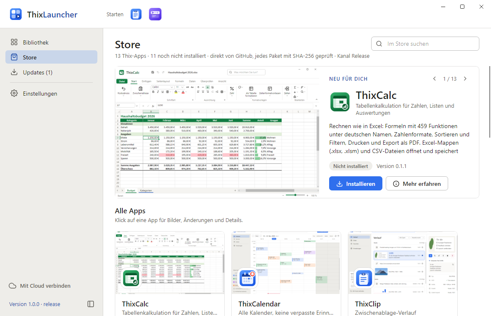
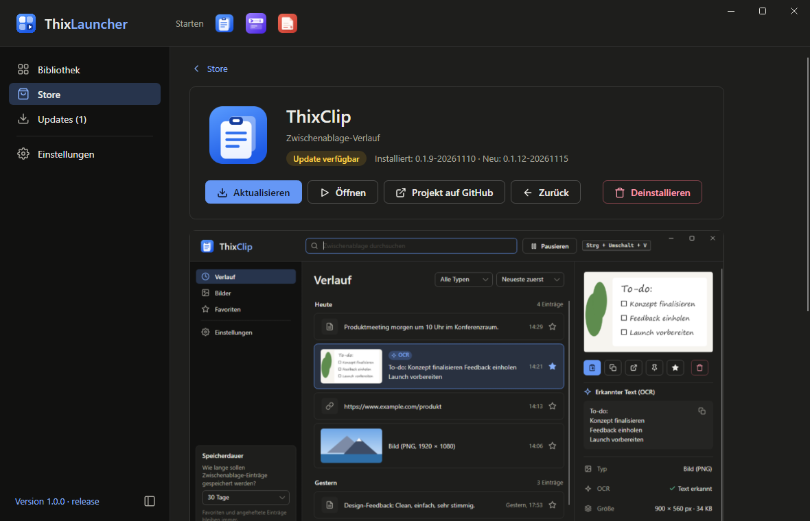
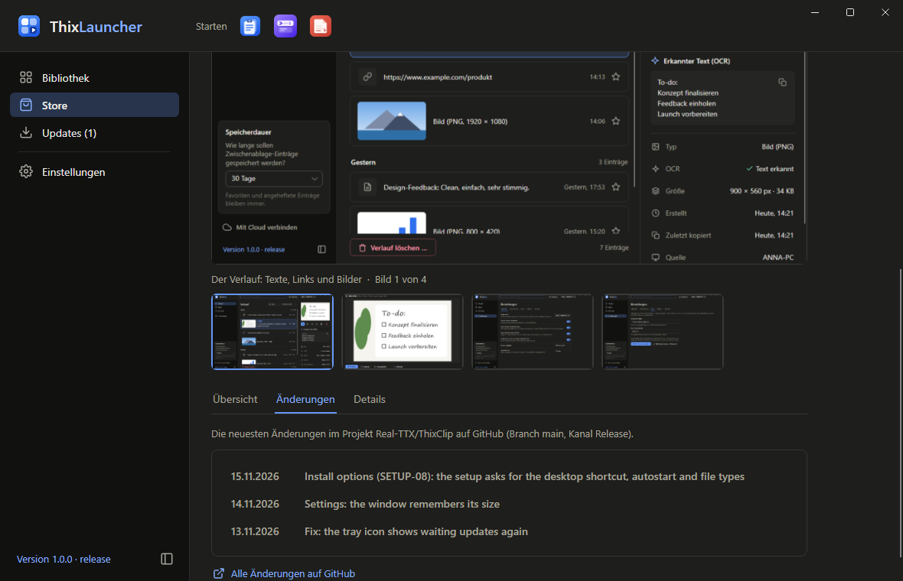
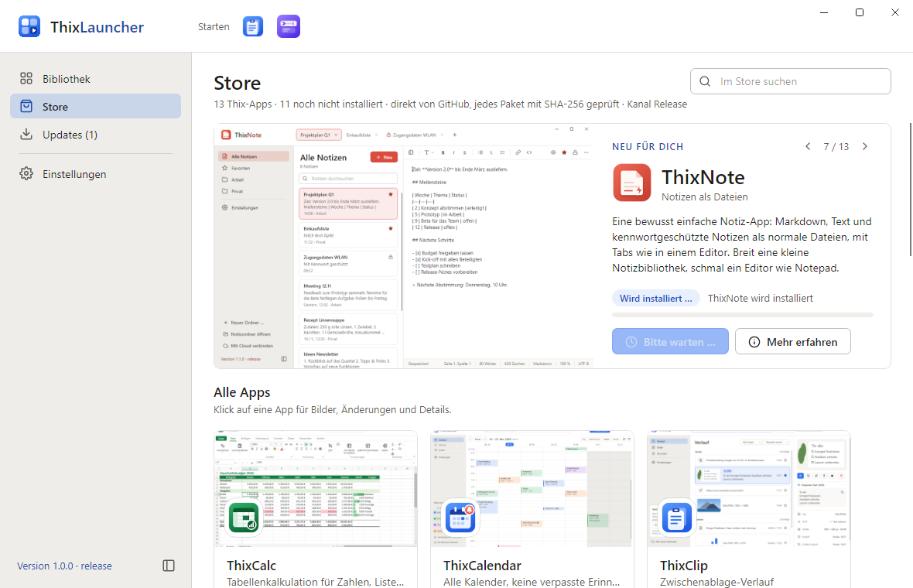
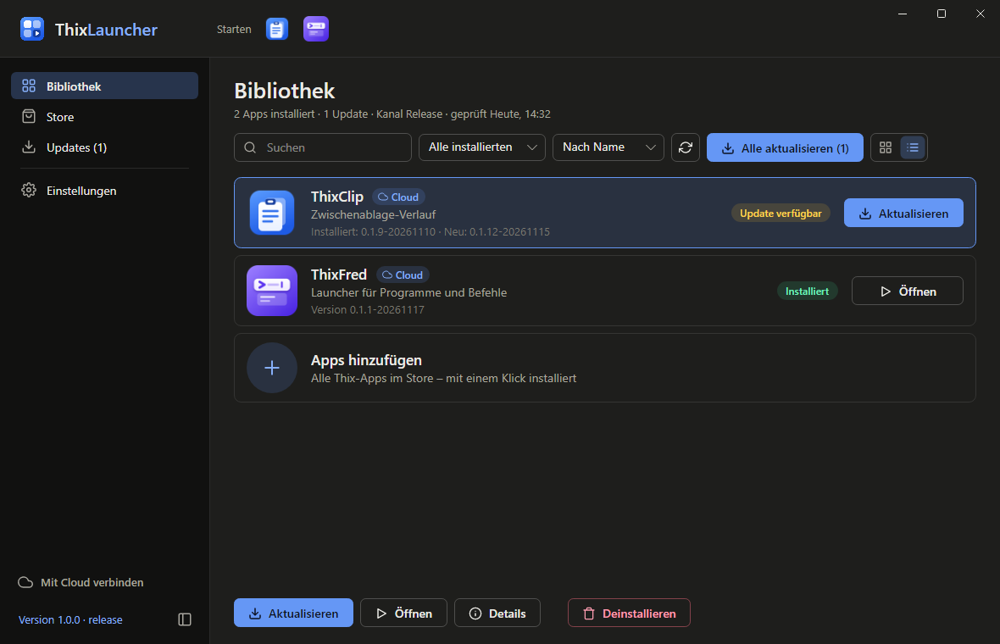
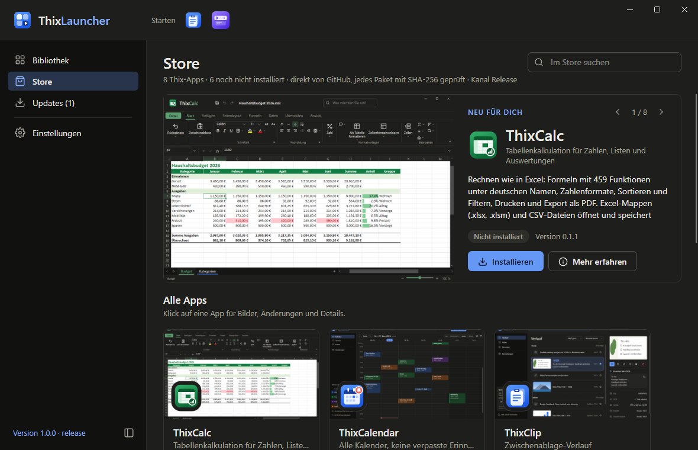
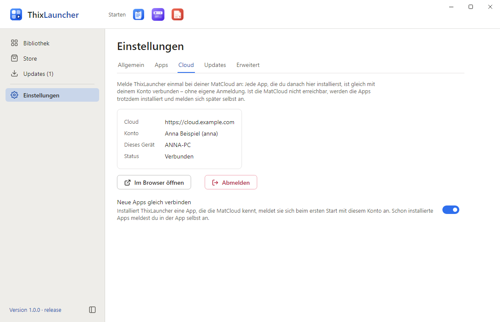
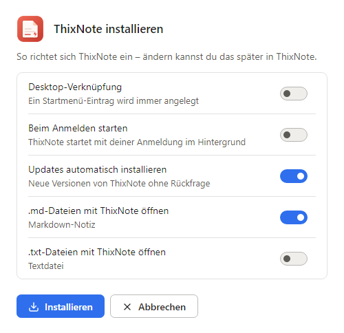

<p align="center"></p>

# ThixLauncher

Der Launcher für die Thix-Apps unter **Windows und macOS**: installieren mit einem Klick, aktuell halten, starten – und
wieder entfernen. Dabei sind **ThixCalc** (Tabellenkalkulation für Zahlen, Listen und Auswertungen), **ThixCalendar** (alle Kalender, keine verpasste Erinnerung), **ThixClip** (Zwischenablage-Verlauf), **ThixContacts** (Adressbuch für Kontakte und Kontaktgruppen), **ThixFred** (Launcher für Programme und Befehle), **ThixMail** (E-Mail, Kalender und Personen in einem Fenster), **ThixNote** (Notizen als Dateien), **ThixShow** (Präsentationen mit Folien, Designs und Bildschirmpräsentation), **ThixTunnel** (SSH-Tunnel) und **ThixWrite** (Textverarbeitung für Dokumente, Briefe und Berichte).
Läuft im Infobereich bzw. in der Menüleiste, ohne Administratorrechte. Aufgebaut wie ein Store: die **Bibliothek** mit den
installierten Apps, der **Store** mit allen Apps – mit ihren Screenshots und Änderungen direkt aus ihren GitHub-Repositorys.



## Screenshots

| Bibliothek (Startseite) | Seite einer App: Bilder von GitHub |
|---|---|
|  |  |

| Änderungen auf GitHub | Eine App installiert sich |
|---|---|
|  |  |

| Bibliothek als Liste (umschaltbar oben rechts) | Store im Dunkeln |
|---|---|
|  |  |

| Einstellungen › Apps | Setup (Windows) |
|---|---|
|  |  |

| Einstellungen › Cloud: angemeldet | Anmeldung im Browser |
|---|---|
|  |  |

## Installation

Fertige Builds gibt es unter [Releases](https://github.com/Real-TTX/ThixLauncher/releases):

- **Windows:** `ThixLauncherSetup.exe` – das Programm ist sein eigenes Setup und installiert sich pro Benutzer nach
  `%LocalAppData%\Programs\ThixLauncher` (ohne Administratorrechte), mit Startmenü, „Installierte Apps“, optional Autostart,
  Desktop-Verknüpfung und automatischen Updates. Entfernen über „Installierte Apps“ oder `ThixLauncher.exe --uninstall [--quiet]`.
- **macOS:** `ThixLauncher-macOS-arm64.dmg` (Apple Silicon) bzw. `-x64.dmg` (Intel) öffnen und ThixLauncher in
  „Programme“ ziehen.

**Ohne Fenster** (ThixInstall, Administratoren) – die Optionen des Setups als Argumente (MatDesign SETUP-05/08; was angeboten
wird, steht in `src/ThixLauncher.Core/installer.json` und im Update-Manifest unter `installer`):

```
ThixLauncherSetup.exe --quiet --desktop-shortcut=yes --autostart=no --automatic-updates=yes [--start]
ThixLauncher --configure --autostart=yes        # nur anwenden (auch macOS)
ThixLauncher.exe --uninstall --quiet
```

Nicht angegebene Optionen: bei der Erstinstallation der Standard, bei einem Update bleibt es, wie es ist. Ein falscher Wert
bricht mit Exit-Code 2 ab (Grund auf stderr und im Protokoll), ohne etwas zu installieren. Dateitypen verknüpft ThixLauncher keine.

Nightlies aus dem Branch `dev` stehen im Pre-Release `nightly-channel`.

## So funktioniert es

- **Die Apps** stehen im Katalog (`AppCatalog`): wo sie ihre Builds veröffentlichen und wie ihr Setup läuft. ThixLauncher
  liest bei jedem Start und alle 6 Stunden, was installiert ist und was der gewählte Kanal anbietet (Release oder
  Nightly) – direkt aus den GitHub-Releases der Apps:
  - **ThixCalc**, **ThixCalendar**, **ThixClip**, **ThixContacts**, **ThixFred**, **ThixMail**, **ThixNote**, **ThixShow**, **ThixTunnel** und **ThixWrite:** das Manifest (`thixcalc-update.json`, `thixcalendar-update.json`, `thixclip-update.json`, `thixcontacts-update.json`, `thixfred-update.json`, `thixmail-update.json`, `thixnote-update.json`, `thixshow-update.json`, `thixtunnel-update.json`, `thixwrite-update.json`) im Release
    `release-channel` / `nightly-channel`. Mehrere Apps aus einem Repository (ThixOffice) teilen sich diese Releases, jede mit
    eigenem Manifest. Eine App, die nur einzelne Releases veröffentlicht, liest ThixLauncher auch
    (`FeedKind.GitHubReleases`: `v…` für Release, Pre-Release `nightly-…` für Nightly, das Paket über seinen Dateinamen).
- **Versionen:** Ein Release ist neuer, wenn Major.Minor größer ist, sonst die Build-Nummer. So zählt ThixNote 1.1.1
  (neuer Workflow ab Build 1) als neuer als 1.0.5.
- **Sicher:** Jedes Paket wird vor der Installation per **SHA-256** geprüft (aus dem Manifest bzw. GitHubs Digest). Ein
  Paket ohne Prüfsumme wird nie installiert.
- **Installieren / Aktualisieren:** unter Windows läuft das Setup der App selbst, ohne Rückfrage
  (`--update`). Ein Setup, das nachfragt, öffnet sich, und ThixLauncher wartet, bis es geschlossen ist. Unter macOS
  ersetzt ThixLauncher das App-Bundle in `/Applications` (bzw. `~/Applications`) und beendet eine laufende App vorher.
- **Installationsoptionen (SETUP-08):** Hat das Manifest einer App den Block `installer` (was ihr Setup anbietet), fragt
  ThixLauncher vor der **ersten** Installation dasselbe wie ihr Setup-Assistent – Desktop-Verknüpfung, Beim Anmelden starten,
  Updates automatisch installieren und je Dateityp „.md-Dateien mit … öffnen“, vorbelegt mit den Standards der App – und gibt die
  Antworten weiter: Windows `<App>Setup.exe --quiet --desktop-shortcut=… --autostart=… --automatic-updates=… --file-types=…|none`
  (dazu `--start`, wenn sie beim Anmelden startet), macOS nach dem Kopieren `<App>.app/Contents/MacOS/<App> --configure …`.
  Lehnt das Setup die Optionen ab (Exit-Code 2), zeigt ThixLauncher seinen Grund. Updates und Apps ohne den Block (ältere Builds)
  laufen wie bisher (`--update`); eine installierte App behält ihre Einstellungen.

  
- **Entfernen:** mit dem Deinstallationsprogramm der App (das stille, wenn es eines gibt). Die Daten der App bleiben.
- **Bibliothek** (Startseite): die installierten Apps als App-Kacheln mit großem Logo (oder als Liste – der
  Schalter neben der Suche, die Wahl bleibt), die letzte Kachel **„Apps hinzufügen“** öffnet den Store. „Updates“ im Menü ist die
  Bibliothek mit den Apps, für die es ein Update gibt.
- **Store:** eine App groß (zuerst die erste, die noch nicht installiert ist; ‹ › blättert durch alle) und darunter alle Apps als
  Kacheln. Ein Klick öffnet die **Seite der App**: ihre Screenshots (eins groß, die anderen zum Anklicken), Übersicht,
  **Änderungen** und Details, mit Installieren / Aktualisieren / Öffnen / Deinstallieren.
- **GitHub, ohne Limit:** Die Screenshots kommen aus `docs/images` des Repositorys der App
  (`raw.githubusercontent.com/<repo>/main/docs/images/…`, im dunklen Design die `-dark`-Variante, sonst die helle), die
  Änderungen aus dem Commit-Feed des Branches des Kanals (`github.com/<repo>/commits/main.atom` bzw. `dev.atom`). Beides ist
  nicht die GitHub-API – deren 60 Anfragen pro Stunde bleiben den Releases. Bilder bleiben im Datenordner (`store/`) und werden
  höchstens einmal am Tag neu gefragt (mit ETag: unverändert = nichts geladen); ohne Verbindung zeigt der Store die gespeicherten.
  Welche Bilder eine App zeigt, steht im Katalog (`ThixApp.Screenshots`).
- **Starten:** aus der Bibliothek, über die Symbole oben in der Titelleiste oder aus dem Menü des Tray-Symbols.
- **Updates von ThixLauncher selbst (OTA):** aus dem eigenen Kanal (`thixlauncher-update.json`), optional als
  **Full-Auto-Update** ohne Rückfrage. Lokale Builds aktualisieren sich nicht.
- **MatCloud:** Unter Einstellungen › Cloud meldet sich ThixLauncher einmal bei der MatCloud an (im Browser mit Code oder mit
  Benutzername und Passwort). Jede App, die er danach **neu installiert**, ist gleich mit demselben Konto verbunden: vor ihrem Setup holt
  ThixLauncher bei der MatCloud eine Anmeldung für die App (`POST /api/v1/devices/handoff`) und legt sie für ihren ersten Start ab
  (`%LocalAppData%\Thix\MatCloud\handoff`, gilt einmal und einen Tag). Ist die MatCloud nicht erreichbar, wird die App trotzdem
  installiert und meldet sich später selbst an – die Cloud hält nie eine Installation auf. Abschaltbar mit „Neue Apps gleich verbinden“.
- **Autostart** bei der Anmeldung (Windows: `HKCU\…\Run`, macOS: LaunchAgent) – unsichtbar im Tray.

### Tastenkürzel (macOS: ⌘ statt Strg)

| Kürzel | Aktion |
|---|---|
| Strg+1 / 2 / 3 | Bibliothek / Store / Updates |
| Strg+F | Suchen (im Store alle Apps, in der Bibliothek die installierten) |
| Strg+R oder F5 | Nach Updates suchen |
| Enter | Seite der gewählten App (auf „Apps hinzufügen“: der Store) |
| Esc | Zurück (von der Seite einer App dorthin, wo sie geöffnet wurde) / Fenster ausblenden |
| Strg+, | Einstellungen |
| Strg+B | Menü ein- und ausklappen |

### Richtlinien für Administratoren

Windows: `HKLM\SOFTWARE\Policies\ThixLauncher` (DWORD = 1), macOS: Konfigurationsprofil `info.schmoldt.thixlauncher`.

| Richtlinie | Wirkung |
|---|---|
| `LockConfiguration` | Die Einstellungen sind schreibgeschützt (Apps starten geht weiter). |
| `DisableAppChanges` | Keine App wird über den Launcher installiert, aktualisiert oder entfernt. |
| `DisableUpdates` | ThixLauncher sucht und installiert keine eigenen Updates. |
| `DisableCloud` | ThixLauncher meldet sich nicht bei der MatCloud an und gibt keine Anmeldung an Apps weiter. |

## Aufbau

| Projekt | Inhalt |
|---|---|
| `src/ThixLauncher.Core` | Modelle, Business-Layer (nur statische Klassen: `AppService`, `AppCatalog`, `SettingsService`, `CloudService`, `UpdateService`, `InstallService`, `AccessPolicy` …), Release-Feeds (`ReleaseFeed`), der Vertrag der MatCloud (`MatCloud/`, Kopie aus MatCloud) und die Plattformen (`WindowsAppSystem`, `MacAppSystem`) |
| `src/ThixLauncher` | Avalonia-UI mit **MatDesktop** (Kopie aus MatDesign): Hauptfenster, Seiten, Tray, Setup, Selbsttest, Snapshots |
| `tests/ThixLauncher.Tests` | Business-Layer gegen GitHub und einen Computer im Speicher, UI headless gerendert |
| `branding` | Logo in vier Detailstufen (Icon, klein, Tray, Wortmarke) und alle gerenderten Größen |

Berechtigungen und Regeln prüft immer der Business-Layer (`AppService`, `SettingsService`), egal was die Oberfläche zeigt.

## Entwickeln

```
dotnet build ThixLauncher.slnx
dotnet test tests/ThixLauncher.Tests
dotnet run --project src/ThixLauncher                      # mit THIXLAUNCHER_DATA_DIR=<Ordner> als eigene Instanz
dotnet run --project src/ThixLauncher -- --snapshot docs/images   # alle Fenster als PNG, hell und dunkel
THIXLAUNCHER_LIVE_FEEDS=1 dotnet test tests/ThixLauncher.Tests --filter LiveFeedTests   # die echten Feeds lesen
cd tools && npm install && node render-icons.js            # Logo neu rendern
```

## Versionierung

| Kanal | Branch | Format | Beispiel |
|---|---|---|---|
| Release | `main` | `<major>.<minor>.<build>-<builddate>` | `0.1.42-20261116` |
| Nightly | `dev` | `nightly-<build>-<builddate>` | `nightly-43-20261116` |
| Local | alle anderen / lokal | `local-<builddate>` | `local-20261116` |

Major/Minor stehen in `Directory.Build.props`, die Build-Nummer ist die Laufnummer des Workflows
`.github/workflows/desktop.yml` (baut jeden Branch; `main` und `dev` veröffentlichen).

© Matthias Schmoldt
